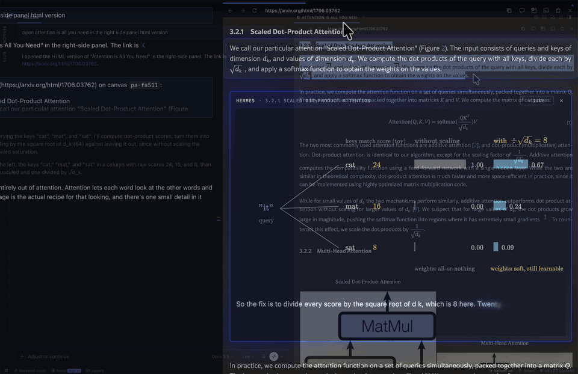

# Vellum

Hermes draws inside the paper.



Highlight a passage in an arXiv paper in Hermes Desktop. Your own Hermes explains it out loud and draws a live figure right under the paragraph, each piece appearing as its sentence is spoken. Ask follow-ups, typed or spoken, and the same figure evolves. Nothing is pre-built: every figure is written live by your model.

Available in the [Hermes Marketplace](https://hermes-agent.nousresearch.com/marketplace/vellum).

## Install

```bash
hermes plugins install vellum --enable
```

Restart Hermes Desktop, then turn on the Desktop half in Capabilities → Plugins → Vellum. Needs Hermes Desktop 0.22.7 or newer.

## Use

1. Open an arXiv paper's HTML version in Hermes's browser (`arxiv.org/html/…`, or `ar5iv.labs.arxiv.org/html/…` for older papers), with a chat next to it.
2. Click **✨ Vellum** in the status bar. Desktop asks once per site. If the page changes (another paper, a reload), Vellum pauses; click ✨ Vellum again to turn it on there.
3. Highlight a passage and click **Visualize**, or **Ask** to add your own question. The request lands in your chat box as a draft; press Enter to send.
4. Keep asking and the figure keeps changing. Click **LIVE** on the figure to go back to normal chat, **Resume** to return.

Vellum never sends a message for you. Leave Desktop's "Read replies aloud" off: Vellum voices replies itself, in step with the drawing.

## How it works

| Piece | What it does |
|---|---|
| `vellum_draw(canvas, say, code)` | One drawing step. `code` is JavaScript run in the figure (D3 and KaTeX available, names persist like notebook cells); `say` is spoken as it appears. |
| `vellum_look(canvas)` | A picture of the figure plus a layout report. |
| `vellum_clear(canvas)` | Start over. |
| `vellum_read(url, offset)` | The paper's full text in chunks, marked as web text. |
| Hooks | `pre_llm_call` adds the skill and the paper around the passage. `pre_tool_call` voices each step and holds it until its sentence plays. `on_stream_delta`, `on_stream_end` and `post_llm_call` voice the reply sentence by sentence with Hermes's `text_to_speech`. |
| Skill `vellum:paper-canvas` | The teaching style: the gist, one concrete example, why it matters. Edit `skills/paper-canvas/SKILL.md` to change it. |
| Desktop half | The status-bar chip, the in-page buttons and the figure card. |

All of this happens only on **paper turns**: a message started from a Visualize or Ask click, a question spoken right after Ask, or a follow-up in the chat that owns the LIVE figure, in an interactive local chat, while the plugin is on. On other turns the hooks only refuse the figure tools and, once, tell Hermes that the user left the paper.

Why a plugin and not a prompt: drawing inside the page needs the Desktop half, keeping voice and drawing in sync needs the stream hooks, and running model-written code safely needs a sandbox.

## Security

- **Figure code** is written by your model and runs only in a sandboxed iframe (`sandbox="allow-scripts"`, opaque origin, CSP `default-src 'none'` with the page's scripts pinned by hash). It can't reach the paper page, your session or your files, and it can't make requests through the browser's normal routes (fetch, images, scripts, frames). Two routes the sandbox and CSP don't govern are handled best effort: WebRTC (its constructors are removed) and a figure navigating its own frame, which nothing in CSP prevents: that one request leaves before the card removes the figure. A model talked into leaking data could still try, but it would have Hermes's own web tools for that anyway, so the sandbox adds no new reach.
- **Paper text is untrusted.** The passage and the text around it are labelled for the model as web content whose instructions must not be followed.
- **You send every message.** Clicks only create a draft. Page events are checked, and a figure card is registered with the backend before its draft exists, so a lookalike message typed by hand does nothing special.
- **Other chats are left alone.** Cron, messaging platforms and subagents never get paper turns, and a figure belongs to the chat that sends its draft first.

## What it touches

- **Pages:** arXiv HTML pages only (arxiv.org/html and ar5iv), with Desktop's per-site consent. It adds the buttons, the figure card, a style sheet and its in-page script; the paper's text is not changed. When you switch Vellum on, it saves the whole paper's text for Hermes (see Stored data).
- **Your model:** the passage and nearby paper text go to whatever model Hermes uses.
- **Voice:** Hermes's own `text_to_speech` with your configured provider (Edge TTS by default), one call per spoken sentence, at most 60 per turn.
- **Stored data** in `<HERMES_HOME>/plugin-data/vellum/`: the text of the 20 most recent papers, the 50 most recent figure card ids, the current Ask, the on/LIVE state, voice clips (about a day) and tool answers (about an hour).
- **Plumbing:** backend routes under `/api/plugins/vellum/` and plugin events `plugin.vellum.*`. The figure frame's CSP allows `'unsafe-eval'` because each drawing step is model-written JavaScript run inside the sandbox.
- No telemetry, no credentials, no external CLIs, no downloads, no compiled binaries.

## Repository layout

| Path | Contents |
|---|---|
| `__init__.py`, `paper_anim/` | Agent half: tool registration, `canvas.py` (the figure tools), `turns.py` (paper turns and voice hooks). |
| `dashboard/` | Backend routes the Desktop half talks to. |
| `desktop/plugin.js` | Desktop half: chip, in-page buttons, figure card. |
| `figure_runtime/` | The sandboxed figure page and its runtime, plus vendored D3, KaTeX and acorn. |
| `skills/paper-canvas/SKILL.md` | The teaching guidance. |
| `tests/` | Run with `uvx --with fastapi pytest -q tests`. |

## License

MIT (see `LICENSE`). Vendored, unmodified, in `figure_runtime/vendor/`: D3 7.9.2 (ISC), KaTeX 0.16.47 (MIT, with its fonts), acorn 8.19.0 (MIT).
